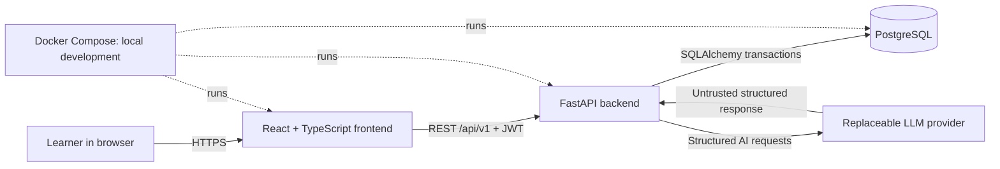
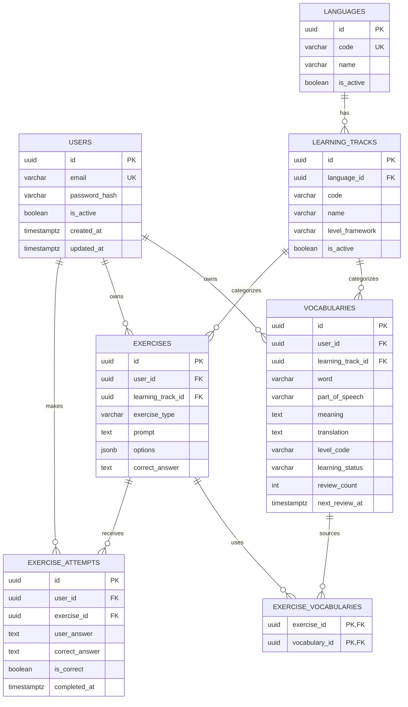

# Mascot — V1 Implementation Plan

## 1. Product scope

### V1 / MVP

Mascot V1 is a multi-user, AI-assisted learning management application for **General English** learners. It will include:

- Account registration, login, logout, and current-user retrieval.
- Secure password hashing and JWT-based protected API access.
- Strict per-user ownership checks for all learning data.
- A shared, read-only Mascot Vocabulary Library organized as Language → Learning Track → Level → Topic/Vocabulary Set → Vocabulary Entries.
- A learner journey that lets a user browse a General English level/topic, select one or more catalog words (or a whole set), and add them to personal learning vocabulary.
- Vocabulary creation, viewing, editing, deletion, search, and filtering.
- Vocabulary metadata: word, part of speech, meaning, translation, one optional example sentence, level, topic, learning status, language/track context, and timestamps.
- A simple self-assessed vocabulary review flow with deterministic counters, status progression, and due dates.
- An AI vocabulary preview workflow: generate, validate, preview/edit, then explicitly save through the normal vocabulary API.
- Multiple-choice and fill-in-the-blank exercises based on the authenticated user's vocabulary.
- Deterministic exercise grading in backend code and stored attempt history.
- A dashboard calculated from PostgreSQL data, not by an LLM.
- A responsive React UI, a versioned FastAPI REST API, PostgreSQL migrations, local Docker Compose development, tests, and setup documentation.

The only AI features planned for V1 are the **AI Vocabulary Assistant** and **AI Exercise Generator**.

Although V1 exposes only General English, shared domain code should use the selected language and track rather than assuming English globally. V1-specific AI prompts and validation may still explicitly target English and Vietnamese where required.

The term **Mascot Vocabulary Library** means shared content curated/provided by Mascot. **My Vocabulary** means user-owned learning records. Importing library content creates personal records; it never changes the shared catalog. Manual and future confirmed AI vocabulary remain valid My Vocabulary sources.

### Future features enabled by the design, but not implemented in V1

- Additional languages, initially Chinese.
- Additional learning tracks such as IELTS, TOEIC, General Chinese, and HSK.
- Track-specific level frameworks, exercise types, content, and analytics.
- More sophisticated spaced repetition and review-event history.
- Richer learning analytics and recommendations.
- An optional Basic AI Tutor, with stateless chat first and saved conversations or carefully scoped learning memory only if later justified.
- Additional translation languages and user language preferences.
- Password reset, email verification, social login, refresh-token sessions, and administrative tools.
- Audio, pronunciation, speech recognition, and voice conversation.
- Provider failover, model routing, or asynchronous AI jobs if usage requires them.

Future capability does not imply that future exam fields, Chinese-specific fields, or HSK-specific behavior should be added now.

### Explicitly out of scope for V1

- IELTS-, TOEIC-, Chinese-, General Chinese-, or HSK-specific features or content.
- Autonomous agents, RAG, web search, voice conversation, or complex long-term memory.
- Basic AI Tutor implementation and tutor navigation; the idea is retained only as a future optional enhancement.
- LLM-based grading of answers that backend code can check deterministically.
- LLM-generated dashboard statistics.
- Automatic saving of AI-generated vocabulary previews.
- Microservices, queues, Kubernetes, event-driven architecture, multiple databases, or a plugin architecture.
- Native mobile applications, teacher/classroom administration, payments, and social/community features.

## 2. Proposed system architecture

Mascot should be a modular monolith: one frontend, one backend, and one PostgreSQL database. This is the smallest architecture that gives clear boundaries, reliable authorization, and room for later language and track expansion.



### React frontend

- Renders authentication, Learn/library browsing, My Vocabulary, review, exercise, and dashboard experiences.
- Uses one application layout with primary navigation (`Home`, `Learn`, `My Vocabulary`, `Review`, and future `Practice`) and exactly one routed page in its content outlet.
- Performs user-friendly form validation, but never replaces backend validation.
- Calls only the FastAPI REST API; it never connects to PostgreSQL or the LLM provider.
- Keeps AI output in preview/edit state until the user explicitly saves it.
- Does not receive AI provider credentials or exercise answer keys before submission.
- Uses a central typed API client and route guards for UX. Route guards are not the authorization boundary; the backend is.

### FastAPI backend

- Owns authentication, authorization, validation, business rules, deterministic grading, review scheduling, and dashboard calculations.
- Separates route handlers, services, Pydantic schemas, SQLAlchemy models, database setup, security helpers, and AI provider adapters.
- Applies the authenticated user's ID in every owned-data query to prevent IDOR vulnerabilities.
- Validates all AI output before returning or storing it.
- Exposes a versioned REST API under `/api/v1` and consistent error responses.

### PostgreSQL

- Is the source of truth for users, catalog data, vocabulary, exercises, and attempts.
- Enforces referential integrity, uniqueness, checks, and important indexes.
- Calculates aggregates through SQL where appropriate; backend code combines results when clearer.
- Is changed only through Alembic migrations.

### AI provider

- Is called only by the backend through an application-owned interface.
- Produces structured candidate vocabulary and exercise content for the two V1 AI features.
- Is treated as unreliable external input: responses are parsed, validated, bounded, and handled with timeouts and safe errors.
- Is not an authentication, authorization, statistics, persistence, or deterministic grading component.

### Docker

- Docker Compose will provide reproducible local frontend, backend, and PostgreSQL services.
- Development configuration will use environment files based on committed `.env.example` files; real `.env` files remain ignored.
- Docker is a packaging/runtime concern, not a service boundary. Production deployment may use managed equivalents without changing the application architecture.

## 3. Domain model

### Languages

A language is the language being learned, such as English or Chinese. It is stable catalog data and is not an exam or curriculum. V1 seeds or migrates only English (`en`).

### Learning tracks

A learning track is a learning program associated with exactly one language. General English, IELTS, and TOEIC are English tracks; General Chinese and HSK are Chinese tracks.

A lightweight `learning_tracks` entity should exist in V1. General English is already a real product context, and representing it now avoids later backfilling a track onto every vocabulary and exercise row. The table remains intentionally small: identity, owning language, display metadata, level framework, and activation state. No exam-specific tables or behavior are introduced.

V1 seeds or migrates only the General English track. The frontend may default to it, but API and service code should resolve a track record rather than rely on a magic English constant throughout the codebase.

### Mascot Vocabulary Library

The library is shared catalog content, not learning progress. A `vocabulary_set` belongs to one learning track and represents one topic at one level. A `vocabulary_entry` belongs to one set and contains the word/sense data shown to every authenticated learner. Neither table has `user_id`.

For General English the hierarchy is English → General English → CEFR level → topic/set → entries. CEFR level and topic remain separate concepts. Phase 3.5 seeds only small, clearly labelled demo sets across A1, A2, B1, and B2; it does not claim to be a complete CEFR dictionary. C1/C2 remain supported level choices even when demo content is empty.

### My Vocabulary (`vocabularies`)

A vocabulary row is a user-owned learning item within one learning track. Its learning language is derived from the track's language, avoiding a duplicated `language_id` that could disagree with the selected track. API responses can include both track and language metadata.

Different users may store the same word. A user may also store multiple senses or parts of speech for the same spelling, so V1 should not impose a broad uniqueness constraint on the word itself.

A personal row may optionally reference `source_vocabulary_entry_id`. Catalog imports copy a snapshot into `vocabularies` so future learning/review data remains user-owned and independently editable. Manual and confirmed AI vocabulary use `NULL`. A partial unique index on (`user_id`, `source_vocabulary_entry_id`) applies only when the source is non-null: this makes catalog imports idempotent without restricting legitimate manual senses.

Personal topics remain lightweight string metadata in V1. Topic suggestions are derived from distinct current-user values, normalized with Unicode normalization, trimmed/collapsed whitespace, and case-insensitive comparison. Users may rename a personal topic across their owned vocabulary or remove it by setting matching rows to `NULL`; neither operation mutates shared catalog topics.

For the same normalized English word, a new personal row is allowed only when both its normalized English definition and normalized Vietnamese translation differ from every existing owned sense. A matching definition or a matching translation is an overlapping sense and returns `409`; part of speech alone never bypasses this rule. Updates exclude the edited row itself, and catalog imports skip overlapping senses without overwriting data.

No `user_vocabulary_sets` table is required in V1. Whole-set and partial progress are derived by comparing catalog entry IDs with the user's source-linked vocabulary. This supports the required UX without introducing enrollment state that could drift from actual learning vocabulary.

### Exercises

An exercise is a user-owned, persistable question in a learning track. V1 supports `multiple_choice` and `fill_in_blank`. It stores enough canonical answer data for deterministic backend grading. The public read schema must omit the answer key until an attempt is graded.

Exercises may be linked to one or more source vocabulary items through a join table. This preserves real foreign keys without putting ID arrays in JSON.

### Exercise attempts

An exercise attempt is an immutable record of one user's submitted answer and the backend's deterministic result. It includes a snapshot of the correct answer so historical records remain interpretable if an exercise is later edited. An attempt must belong to the same user as its exercise; the service enforces that by loading the exercise through the authenticated user's scope before inserting the attempt.

### Review progress

V1 review progress lives on the vocabulary row: aggregate counts plus last/next review times. A separate review-event table is deferred until product requirements need full review history or a richer scheduling algorithm.

### Future optional tutor conversations

Basic AI Tutor is not part of V1. If revisited, it should begin as stateless chat with bounded client-supplied context; no conversation or message tables are planned until concrete retention requirements exist.

## 4. Proposed database schema

General conventions:

- Use UUID primary keys to avoid exposing sequential record counts and to work cleanly across environments.
- Use timezone-aware `created_at` and `updated_at` timestamps (`TIMESTAMPTZ`) generated by the backend/database consistently.
- Use explicit foreign-key delete behavior. User deletion is not part of V1; destructive cascades should not be relied upon as a user-facing deletion workflow.
- Store constrained values as strings with database `CHECK` constraints where the set is stable in V1. Mirror these constraints with Python enums/literals in Pydantic.
- Keep all owned-data queries scoped by `user_id`; PostgreSQL row-level security is not required for this single-backend MVP.

### `users`

| Column | Proposed type | Rules / purpose |
|---|---|---|
| `id` | UUID | Primary key. |
| `email` | VARCHAR(320) | Required; trimmed and normalized to lowercase before storage. |
| `password_hash` | VARCHAR | Required; Argon2id hash, never plaintext. |
| `is_active` | BOOLEAN | Required, default `true`; allows access to be disabled later. |
| `created_at` | TIMESTAMPTZ | Required. |
| `updated_at` | TIMESTAMPTZ | Required. |

- Primary key: `id`.
- Constraints: unique normalized `email`; nonblank email and password hash.
- Indexes: unique B-tree index on `email`.
- Relationships: one user owns many vocabularies, exercises, and exercise attempts.
- The registration service must always store the canonical lowercase email so database uniqueness is reliable without requiring PostgreSQL-specific `CITEXT` in V1.

### `languages`

| Column | Proposed type | Rules / purpose |
|---|---|---|
| `id` | UUID | Primary key. |
| `code` | VARCHAR(16) | Required language code such as `en`; unique and stable. |
| `name` | VARCHAR(100) | Required English/system display name. |
| `native_name` | VARCHAR(100) | Optional native display name. |
| `is_active` | BOOLEAN | Required, default `true`. |
| `created_at` | TIMESTAMPTZ | Required. |
| `updated_at` | TIMESTAMPTZ | Required. |

- Primary key: `id`.
- Constraints: unique lowercase `code`; code and name cannot be blank.
- Indexes: unique index on `code`; optional index on `is_active` only if catalog size/use later justifies it.
- Relationships: one language has many learning tracks.
- V1 data: English only. Chinese is not seeded as a selectable V1 language.

### `learning_tracks`

| Column | Proposed type | Rules / purpose |
|---|---|---|
| `id` | UUID | Primary key. |
| `language_id` | UUID | Required foreign key to `languages.id`. |
| `code` | VARCHAR(64) | Stable per-language code such as `general-english`. |
| `name` | VARCHAR(120) | Required display name. |
| `description` | TEXT | Optional. |
| `level_framework` | VARCHAR(32) | Required for V1, value `CEFR`; allows a future track to declare another framework without changing shared vocabulary code. |
| `is_active` | BOOLEAN | Required, default `true`. |
| `created_at` | TIMESTAMPTZ | Required. |
| `updated_at` | TIMESTAMPTZ | Required. |

- Primary key: `id`.
- Foreign key: `language_id -> languages.id`, delete restricted.
- Constraints: unique (`language_id`, `code`); nonblank code/name/framework.
- Indexes: index on `language_id`; unique composite index on (`language_id`, `code`).
- Relationships: belongs to one language; has many vocabularies and exercises.
- V1 data: General English only. No IELTS, TOEIC, General Chinese, or HSK rows or behaviors.

### `vocabulary_sets`

| Column | Proposed type | Rules / purpose |
|---|---|---|
| `id` | UUID | Primary key. |
| `learning_track_id` | UUID | Required FK to `learning_tracks`; language is derived through the track. |
| `name` | VARCHAR(160) | Required display name. |
| `description` | TEXT | Optional; demo seed descriptions are clearly marked. |
| `level_code` | VARCHAR(32) | Required; CEFR in General English V1, generic for later frameworks. |
| `topic` | VARCHAR(120) | Required topic distinct from level. |
| `order_index` | INTEGER | Required nonnegative display order. |
| `is_active` | BOOLEAN | Required; inactive sets are not browseable/importable. |
| `created_at`, `updated_at` | TIMESTAMPTZ | Required. |

- Unique constraint: (`learning_track_id`, `level_code`, `topic`).
- Indexes: (`learning_track_id`, `level_code`, `is_active`) and `topic`.
- Shared catalog table: intentionally has no `user_id`.

### `vocabulary_entries`

| Column | Proposed type | Rules / purpose |
|---|---|---|
| `id` | UUID | Primary key. |
| `vocabulary_set_id` | UUID | Required FK to `vocabulary_sets`, cascade only when catalog set is removed. |
| `word`, `normalized_word` | VARCHAR(255) | Required display and normalized search forms. |
| `part_of_speech` | VARCHAR(64) | Required. |
| `meaning`, `translation` | TEXT | Required English definition and V1 Vietnamese translation. |
| `translation_language_code` | VARCHAR(16) | Required, default `vi`. |
| `example_sentences` | JSONB | Required validated array of strings. |
| `order_index` | INTEGER | Required nonnegative order inside the set. |
| `created_at`, `updated_at` | TIMESTAMPTZ | Required. |

- Indexes: (`vocabulary_set_id`, `order_index`) and `normalized_word`.
- Shared catalog table: intentionally has no `user_id`; level/topic are derived from its set to avoid disagreement.

### `vocabularies`

| Column | Proposed type | Rules / purpose |
|---|---|---|
| `id` | UUID | Primary key. |
| `user_id` | UUID | Required owner foreign key to `users.id`. |
| `learning_track_id` | UUID | Required foreign key to `learning_tracks.id`; language is obtained through this relationship. |
| `source_vocabulary_entry_id` | UUID | Nullable FK to `vocabulary_entries.id`; `NULL` for manual/AI-created items, `ON DELETE SET NULL`. |
| `word` | VARCHAR(255) | Required, trimmed, nonblank. Unicode-capable. |
| `part_of_speech` | VARCHAR(64) | Required; string rather than a database enum so other languages can extend it later. |
| `meaning` | TEXT | Required simple target-language definition for V1. |
| `translation` | TEXT | Required V1 Vietnamese translation. |
| `translation_language_code` | VARCHAR(16) | Required, default `vi`; prevents the shared storage model from assuming every translation is Vietnamese forever. |
| `example_sentences` | JSONB | Required JSON array, default `[]`, constrained by application schemas to zero or one sentence. The existing column is retained to avoid an unnecessary migration. |
| `level_code` | VARCHAR(32) | Required in V1; `A1`–`C2` under the General English track's CEFR framework. Named generically for future frameworks. |
| `topic` | VARCHAR(120) | Optional normalized display/filter value. |
| `learning_status` | VARCHAR(20) | Required; `new`, `learning`, `review`, or `mastered`; default `new`. |
| `review_count` | INTEGER | Required, default `0`, nonnegative. |
| `correct_count` | INTEGER | Required, default `0`, nonnegative. |
| `incorrect_count` | INTEGER | Required, default `0`, nonnegative. |
| `last_reviewed_at` | TIMESTAMPTZ | Nullable until reviewed. |
| `next_review_at` | TIMESTAMPTZ | Nullable; set when the item enters a scheduled review flow. |
| `created_at` | TIMESTAMPTZ | Required. |
| `updated_at` | TIMESTAMPTZ | Required. |

- Primary key: `id`.
- Foreign keys: `user_id -> users.id`; `learning_track_id -> learning_tracks.id`, both delete restricted in the initial migration.
- Checks: allowed V1 learning statuses; all counters nonnegative; `correct_count + incorrect_count <= review_count`; `example_sentences` must be a JSON array; required text is nonblank. Pydantic additionally allows at most one nonblank example sentence of bounded length.
- Level validation: the V1 service/schema accepts only CEFR `A1`, `A2`, `B1`, `B2`, `C1`, or `C2`. Do not add a database check that globally assumes every future track uses CEFR; track-aware validation belongs in the service until a generic proficiency catalog is actually needed.
- Indexes:
  - (`user_id`, `created_at DESC`) for listing and recent vocabulary.
  - (`user_id`, `learning_track_id`, `learning_status`) for status filters.
  - (`user_id`, `learning_track_id`, `level_code`) for level filters.
  - (`user_id`, `learning_track_id`, `topic`) for topic filters.
  - (`user_id`, `next_review_at`) with a partial condition where `next_review_at IS NOT NULL` for due reviews.
  - A functional index on (`user_id`, `learning_track_id`, `lower(word)`) for exact/prefix case-insensitive lookup. Add trigram search later only if measured search needs justify it.
- Relationships: belongs to a user and track; may contribute to many exercises through `exercise_vocabularies`.
- No broad uniqueness constraint on (`user_id`, `word`): genuinely different senses remain legitimate. Service validation rejects an owned same-word row whenever either definition or translation overlaps an existing sense and returns safe `409` metadata for a “View existing word” action.
- A partial unique index on (`user_id`, `source_vocabulary_entry_id`) where the source is not null prevents accidental duplicate catalog imports while preserving unlimited manual senses/usages.

### `exercises`

| Column | Proposed type | Rules / purpose |
|---|---|---|
| `id` | UUID | Primary key. |
| `user_id` | UUID | Required owner foreign key. |
| `learning_track_id` | UUID | Required track foreign key. |
| `exercise_type` | VARCHAR(32) | Required; `multiple_choice` or `fill_in_blank`. |
| `prompt` | TEXT | Required question text. |
| `options` | JSONB | Multiple-choice option objects; nullable for fill-in-the-blank. |
| `correct_answer` | TEXT | Required canonical answer or option ID; internal only before grading. |
| `acceptable_answers` | JSONB | Required array, default `[]`; optional normalized alternatives for fill-in-the-blank. |
| `explanation` | TEXT | Optional answer explanation. |
| `source` | VARCHAR(20) | Required; `manual` for controlled demo content and `ai` for the later Phase 7 generator. |
| `created_at` | TIMESTAMPTZ | Required. |
| `updated_at` | TIMESTAMPTZ | Required. |

- Primary key: `id`.
- Foreign keys: `user_id -> users.id`; `learning_track_id -> learning_tracks.id`, delete restricted.
- Checks: allowed exercise types and sources; required text is nonblank; JSON values are arrays; multiple-choice exercises require a bounded option array and a correct option ID (structural and membership validation is primarily Pydantic/service logic); fill-in-the-blank requires a canonical answer.
- Indexes: (`user_id`, `learning_track_id`, `created_at DESC`) and (`user_id`, `exercise_type`).
- Relationships: belongs to a user and track; links to vocabulary rows; has many attempts.
- Public response schemas must not expose `correct_answer` or `acceptable_answers` before a submission is graded.

### `exercise_vocabularies`

| Column | Proposed type | Rules / purpose |
|---|---|---|
| `exercise_id` | UUID | Foreign key to `exercises.id`. |
| `vocabulary_id` | UUID | Foreign key to `vocabularies.id`. |

- Primary key: composite (`exercise_id`, `vocabulary_id`).
- Foreign keys: both references use `ON DELETE CASCADE` because this table contains links only, not learning history.
- Indexes: the primary key supports exercise-to-vocabulary lookup; add an index on `vocabulary_id` for the reverse lookup.
- Ownership rule: the generation service first loads both exercise context and all requested vocabulary through the same authenticated `user_id`, then inserts links in one transaction. Cross-user IDs are rejected as not found. A database-level composite owner constraint can be added later if another trusted writer bypasses the backend.

### `exercise_attempts`

| Column | Proposed type | Rules / purpose |
|---|---|---|
| `id` | UUID | Primary key. |
| `user_id` | UUID | Required owner foreign key. |
| `exercise_id` | UUID | Required foreign key to `exercises.id`. |
| `user_answer` | TEXT | Required submitted answer/option ID. |
| `correct_answer` | TEXT | Required answer snapshot at grading time. |
| `is_correct` | BOOLEAN | Required deterministic result. |
| `completed_at` | TIMESTAMPTZ | Required completion time. |

- Primary key: `id`.
- Foreign keys: `user_id -> users.id`; `exercise_id -> exercises.id`, delete restricted so attempts remain valid learning history.
- Constraints: submitted and correct answers are nonblank.
- Indexes: (`user_id`, `completed_at DESC`) for history/dashboard; (`user_id`, `is_correct`) for accuracy aggregates; `exercise_id` for exercise history.
- Relationships: belongs to one user and one exercise. Multiple attempts per exercise are allowed.
- Ownership rule: the backend selects the exercise by both `exercise_id` and authenticated `user_id`; it never trusts a request-body user ID. The insert uses the authenticated user ID only.

### Derived dashboard data (no table)

Dashboard values should be queried from source tables:

- Total, learning, and mastered vocabulary: conditional counts over `vocabularies` scoped by user and selected track.
- Due vocabulary: `next_review_at <= now()` and an eligible non-mastered/status policy, scoped by user.
- Exercises completed and accuracy: count and average/sum over `exercise_attempts` scoped by user; define whether “completed” means attempts or distinct exercises before implementation.
- Recently learned vocabulary: a limited list ordered by a reviewed/created rule agreed before implementation.

Do not persist a dashboard summary table in V1.

### ER diagram



## 5. Proposed REST API

Conventions:

- Base path: `/api/v1`.
- JSON request/response bodies, consistent error envelope, and appropriate status codes.
- List endpoints use bounded pagination (`limit` plus `offset` for V1) and deterministic ordering.
- IDs in request bodies never establish ownership. Ownership always comes from the authenticated JWT subject.
- A resource owned by another user should generally return `404` rather than reveal that it exists.
- Validation errors use `422`; invalid credentials use `401`; authenticated but disallowed actions use `403` where existence disclosure is not a concern; duplicate email uses `409`.

### Authentication

| Method | Path | Purpose | Authentication |
|---|---|---|---|
| `POST` | `/auth/register` | Create a user with normalized email and securely hashed password; return safe user data and optionally a token according to the final UX decision. | No |
| `POST` | `/auth/login` | Verify credentials and issue a short-lived JWT. | No |
| `POST` | `/auth/logout` | Complete the selected logout mechanism; for access-token-only V1 this confirms logout while the client discards its token. | Yes |
| `GET` | `/auth/me` | Return the current active user's safe profile. | Yes |

Password hashes and token internals are never returned.

### Catalog

| Method | Path | Purpose | Authentication |
|---|---|---|---|
| `GET` | `/catalog/languages` | List active supported languages; V1 returns English only. | Yes |
| `GET` | `/catalog/learning-tracks` | List active tracks, optionally filtered by `language_code`; V1 returns General English only. | Yes |

These endpoints prevent the frontend from hardcoding database UUIDs. They do not expose future inactive/unsupported tracks. Legacy `/languages` and `/learning-tracks` aliases remain temporarily available so Phase 3 clients do not break.

### Vocabulary Library

| Method | Path | Purpose | Authentication |
|---|---|---|---|
| `GET` | `/vocabulary-sets` | Paginated shared sets; filters: `language`, `learning_track`, `level`, `topic`. Returns per-user added counts/status without changing catalog ownership. | Yes |
| `GET` | `/vocabulary-sets/{set_id}` | Set metadata and ordered entries, each annotated with whether the current user already added it. | Yes |
| `POST` | `/vocabulary-entries/{entry_id}/add-to-my-vocabulary` | Idempotently add one active catalog entry to the current user's vocabulary. | Yes |
| `POST` | `/vocabulary-entries/import` | Validate and idempotently add a bounded selection of entry IDs. | Yes |
| `POST` | `/vocabulary-sets/{set_id}/start-learning` | Idempotently copy all active entries in a set into the current user's vocabulary. | Yes |

Import requests never accept `user_id`. Invalid/inactive IDs fail without partial insertion. Each imported personal row starts as `new` and preserves `source_vocabulary_entry_id`. Repeated imports are successful no-ops reported through created/skipped counts.

### Vocabulary

| Method | Path | Purpose | Authentication |
|---|---|---|---|
| `POST` | `/vocabularies` | Explicitly save a validated user-owned vocabulary item. This is also how an edited AI preview is saved. | Yes |
| `GET` | `/vocabularies` | Paginated list/search. Supports `q`, `learning_status`, `level`, `topic`, and `learning_track_id` filters. In V1, `level` is a CEFR value. | Yes |
| `GET` | `/vocabularies/{vocabulary_id}` | Get one vocabulary item owned by the current user. | Yes |
| `PATCH` | `/vocabularies/{vocabulary_id}` | Partially update an owned item using a dedicated update schema. | Yes |
| `DELETE` | `/vocabularies/{vocabulary_id}` | Delete an owned item and its exercise links; existing exercises/attempts remain. Return `204`. | Yes |
| `GET` | `/vocabularies/topics` | Return normalized, counted current-user topic suggestions with bounded typeahead search. | Yes |
| `PATCH` | `/vocabularies/topics` | Rename all current-user vocabulary rows matching one normalized personal topic. | Yes |
| `DELETE` | `/vocabularies/topics` | Set the matching personal topic to `NULL` without deleting vocabulary. | Yes |

### Vocabulary review

| Method | Path | Purpose | Authentication |
|---|---|---|---|
| `GET` | `/vocabularies/due-for-review` | Return a bounded owned-vocabulary queue whose `next_review_at` is due, with `limit` and optional track scope. | Yes |
| `POST` | `/vocabularies/{vocabulary_id}/reviews` | Record a simple correct/incorrect review outcome and atomically update counts, status, and schedule. | Yes |

The Phase 4 scheduling policy is deterministic and self-assessed. Any non-mastered vocabulary with `next_review_at IS NULL` or `next_review_at <= now()` is due. A correct result advances `new → learning` and schedules one day later, then `learning → review` and schedules three days later, then `review → mastered` with no next due date. An incorrect result from any due non-mastered state returns the item to `learning` and schedules one hour later. Each submission atomically increments `review_count` and the matching result counter, and updates `last_reviewed_at`. Mastered or not-yet-due items cannot be submitted through the review endpoint.

### Exercises and attempts

| Method | Path | Purpose | Authentication |
|---|---|---|---|
| `GET` | `/exercises` | List the current user's exercises, filterable by track/type and paginated; omit answer keys. | Yes |
| `GET` | `/exercises/{exercise_id}` | Return one owned exercise without its answer key. | Yes |
| `POST` | `/exercises/{exercise_id}/attempts` | Submit an answer, grade it in backend code, store the immutable attempt, then return correctness, canonical answer, and explanation. | Yes |
| `GET` | `/exercise-attempts` | List the current user's attempt history, optionally filtered by exercise/track. | Yes |

For multiple choice, the submitted stable option ID is compared with the stored option ID. For fill-in-the-blank, backend normalization may trim whitespace and optionally compare case-insensitively against canonical/acceptable answers. The normalization policy must be documented and unit-tested; the LLM is never called to grade these types.

### Dashboard

| Method | Path | Purpose | Authentication |
|---|---|---|---|
| `GET` | `/dashboard/summary` | Return vocabulary counts, due count, attempt/exercise totals, accuracy, and recent vocabulary for the current user and optional track. | Yes |

All numbers come from SQL/backend calculations. Empty denominators return a defined value such as `null` accuracy rather than a divide-by-zero error.

### AI

| Method | Path | Purpose | Authentication |
|---|---|---|---|
| `POST` | `/ai/vocabulary` | Accept one word, request structured vocabulary data, validate it, and return an unsaved preview. | Yes |
| `POST` | `/ai/exercises/generate` | Accept owned vocabulary IDs, track, exercise types, and a bounded count; generate and validate exercises, persist them as owned records, and return public exercise schemas without answer keys. | Yes |

AI endpoints require authentication for ownership, abuse control, and cost attribution. They should enforce request-size/count limits, provider timeouts, and safe provider error mapping (for example `502`/`503` rather than leaking provider details).

### Operational endpoint

| Method | Path | Purpose | Authentication |
|---|---|---|---|
| `GET` | `/health` | Basic application liveness; a separate readiness check may verify database connectivity without exposing internals. | No |

## 6. Proposed project folder structure

This is the expected future structure, not a request to create it during planning:

```text
Mascot/
├── frontend/
│   ├── src/
│   │   ├── api/                 # Typed HTTP client and endpoint modules
│   │   ├── app/                 # App shell, providers, router, global setup
│   │   ├── components/          # Reusable presentational components
│   │   ├── features/
│   │   │   ├── auth/
│   │   │   ├── learn/             # Shared library levels, sets, entry selection/import
│   │   │   ├── vocabulary/
│   │   │   ├── review/
│   │   │   ├── exercises/
│   │   │   └── dashboard/
│   │   ├── hooks/               # Cross-feature React hooks
│   │   ├── types/               # Shared frontend-only TypeScript types
│   │   ├── utils/               # Small framework-independent helpers
│   │   └── test/                # Test setup and shared test utilities
│   ├── public/
│   ├── .env.example
│   ├── Dockerfile
│   ├── package.json
│   ├── tsconfig.json
│   └── vite.config.ts
├── backend/
│   ├── app/
│   │   ├── api/
│   │   │   ├── dependencies.py  # Current user, DB session, common dependencies
│   │   │   └── v1/
│   │   │       ├── router.py    # Versioned router composition
│   │   │       └── routes/      # Thin auth, vocabulary, review, AI, etc. routes
│   │   ├── ai/
│   │   │   ├── base.py          # Provider protocol/interface and domain errors
│   │   │   ├── provider.py      # Selected provider adapter
│   │   │   └── prompts/         # Versioned, task-specific prompt construction
│   │   ├── core/
│   │   │   ├── config.py        # Validated environment settings
│   │   │   ├── errors.py        # Application error types/handlers
│   │   │   ├── logging.py       # Safe structured logging configuration
│   │   │   └── security.py      # Hashing and JWT helpers
│   │   ├── db/
│   │   │   ├── base.py          # Declarative model registration
│   │   │   └── session.py       # Engine/session lifecycle
│   │   ├── models/              # SQLAlchemy persistence models
│   │   ├── schemas/             # Pydantic request/response/AI schemas
│   │   ├── services/            # Business logic and transaction boundaries
│   │   ├── repositories/        # Add only where repeated query logic merits it
│   │   └── main.py              # FastAPI application factory/wiring
│   ├── alembic/
│   │   └── versions/            # Reviewed schema migrations
│   ├── tests/
│   │   ├── unit/
│   │   ├── integration/
│   │   └── fixtures/
│   ├── .env.example
│   ├── alembic.ini
│   ├── Dockerfile
│   └── pyproject.toml
├── .env.example                 # Compose-level variable names/examples
├── .gitignore                   # Must ignore all real .env files and secrets
├── docker-compose.yml
├── PLAN.md
└── README.md
```

Important boundaries:

- Routes translate HTTP concerns and call services; they do not contain substantial business logic.
- Services enforce ownership, coordinate transactions, perform deterministic grading/scheduling, and call the AI interface.
- Schemas define public contracts and prevent persistence models or answer keys from leaking directly.
- Models define storage relationships and constraints; they are not used as request bodies.
- `repositories/` is optional. Introduce it only for query logic that would otherwise be duplicated; do not require a repository wrapper for every table.
- AI prompts are task-specific. English/Vietnamese instructions can live in V1 prompt builders without contaminating authentication, storage, or exercise-grading logic.

## 7. AI architecture

### Call location and provider abstraction

All LLM calls happen inside the FastAPI backend. Route handlers call an application service, and that service calls a narrow provider interface such as:

- `generate_vocabulary(request) -> VocabularyCandidate`
- `generate_exercises(request) -> list[ExerciseCandidate]`

The interface returns application schemas and raises provider-neutral errors. The default V1 adapter calls Groq's OpenAI-compatible Responses API with `openai/gpt-oss-20b`; the existing OpenAI-hosted adapter remains an environment-selected fallback. The shared OpenAI-compatible implementation handles authentication, model name, timeout, and native structured output. Switching providers does not change vocabulary persistence or grading.

Do not build dynamic model routing, retries across vendors, or automatic failover in V1. A narrow interface and explicit environment-selected adapters are enough.

### Backend-only keys

Provider API keys and model configuration live in backend environment variables and backend secret storage in deployment. The browser calls Mascot's authenticated API, never the provider directly. This prevents exposing reusable credentials, allows rate/cost controls, centralizes prompt/version management, and ensures AI output passes backend validation.

Real `.env` files are ignored. Committed `.env.example` files contain names and safe placeholders only. Logs must not include secrets, authorization headers, complete provider payloads containing sensitive user data, or raw stack traces returned to users.

### Structured output and validation

AI output is untrusted even when a provider supports JSON schema. The backend should:

1. Request a strict task-specific schema from the provider.
2. Parse the response into dedicated Pydantic AI candidate schemas.
3. Enforce bounds: word/prompt lengths, allowed V1 part-of-speech representation, CEFR values, example count, option count, stable option IDs, and answer membership.
4. Verify requested track and every vocabulary ID belongs to the authenticated user.
5. Reject or make one bounded repair/retry attempt for malformed output; never run an unbounded retry loop.
6. Map timeouts, quota/rate limits, provider failures, and invalid responses to safe application errors.

For vocabulary generation, the validated result remains a preview and is **not inserted**. The user edits it and explicitly calls `POST /vocabularies`.

For exercise generation, validated candidates are persisted in one transaction because an exercise needs a stable ID before attempts can reference it. The API returns a public schema with answer keys removed. Whether exercise preview/approval is desired should be confirmed before implementation because it is not required by the current scope.

### Appropriate AI use

Use AI for:

- Drafting definitions, Vietnamese translations, CEFR estimates, and example sentences.
- Drafting multiple-choice and fill-in-the-blank questions from owned vocabulary.

Do not use AI for:

- Password/authentication decisions, authorization, ownership, or input security.
- Saving vocabulary without explicit user action.
- Checking multiple-choice or simple fill-in-the-blank answers.
- Review counters, schedules, dashboard totals, accuracy, or other arithmetic.
- Database access decisions or deciding which records belong to a user.
- Web search, RAG, autonomous actions, or persistent memory in V1.

### Cost and reliability controls

- Authenticate all AI requests and impose per-request bounds.
- Configure hard timeouts, conservative output token limits, and a small bounded retry policy.
- Record safe operational metrics such as task type, latency, provider status, and token/cost estimates without logging secrets or unnecessary prompt content.
- Add rate limiting before public production launch, at the API/edge or application layer.
- Make failure recoverable in the UI: keep the user's input, show a retryable error, and never create partial records.

## 8. Authentication and authorization design

### Registration

- Validate the email and a minimum password policy with Pydantic/service rules.
- Normalize email to lowercase and enforce database uniqueness.
- Hash the password with Argon2id using a maintained password library and safe defaults.
- Store only the hash. Never log or return the password or hash.
- Handle duplicate-email races via the database constraint and return a safe `409` response.

### Login and JWT

- Look up the normalized email and verify the hash using the password library.
- Return the same generic invalid-credentials response for unknown emails and incorrect passwords.
- Issue a short-lived signed JWT containing at minimum `sub` (user UUID), `iat`, `exp`, and preferably `jti`.
- Load the user on protected requests and reject missing, invalid, expired, or inactive-user tokens with `401`.
- Keep signing keys, algorithm configuration, issuer/audience, and expiry in validated backend settings. Use a strong environment secret for an initial symmetric algorithm; asymmetric keys can be adopted later if multiple token-verifying services ever exist.

The simplest V1 session is an access token sent in the `Authorization: Bearer` header, held in frontend memory, and discarded on logout. This minimizes server state and avoids long-lived token storage, but requires login again after a full reload. If persistent sessions are a launch requirement, add a deliberate refresh-token design (rotation, hashed token storage, revocation, and cookie/CSRF policy) rather than putting a long-lived JWT in `localStorage`. This must be decided before authentication implementation.

### Logout

With access-token-only JWTs, logout clears frontend authentication state; the short-lived token remains valid until expiry. The authenticated logout endpoint can provide a consistent workflow but cannot revoke a stolen stateless token. Immediate revocation requires a refresh/session table or denylist and is deferred unless the product requires it.

### Protected endpoints and ownership

- A reusable dependency authenticates the JWT and returns the active current user.
- Owned service queries use both the requested resource ID and `current_user.id`, for example `WHERE id = :id AND user_id = :current_user_id`.
- Create requests never accept or trust `user_id`; it is injected from the current user.
- Nested operations first load the parent in the same user scope. Exercise generation loads every vocabulary ID with the same user and requested track and rejects the request if the full set is not owned.
- Attempts are graded only after loading the exercise through the current user's scope.
- Foreign-user resources return `404` in ownership-sensitive paths to limit record enumeration.
- List, search, dashboard, recent, and due-review queries are also scoped—not only single-record routes.
- Frontend route guards improve UX but do not grant access.

### Additional safeguards

- Allow only explicit CORS origins from environment configuration; never combine wildcard origins with credentials.
- Enforce bounded request sizes, pagination limits, AI batch limits, and field lengths.
- Return centralized safe errors and log correlation IDs/details server-side without credentials or sensitive payloads.
- Use TLS in production, secure database credentials, dependency scanning, and rate limits for login/registration/AI endpoints.
- Do not put secrets or sensitive claims in JWT payloads; signed JWT payloads are readable, not encrypted.

## 9. Implementation phases

Testing and documentation should be added within each phase; Phase 9 is a cross-cutting hardening pass, not the first time tests are written.

### Phase 1 — Project scaffold and local infrastructure

- Create React/TypeScript/Vite and FastAPI application skeletons.
- Establish configuration loading, dependency management, linting/formatting, versioned API routing, error envelope, CORS, logging, database session lifecycle, Alembic, Dockerfiles, and Docker Compose.
- Add `.gitignore`, safe `.env.example` files, health endpoint, and initial README.
- Add the initial migration for `users`, `languages`, and `learning_tracks`, with only English and General English catalog data.

### Phase 2 — Authentication and user isolation foundation

- Add user model/schemas/services/routes, Argon2id hashing, JWT creation/verification, current-user dependency, and frontend auth flow.
- Decide token persistence/refresh behavior before coding the client storage strategy.
- Add authentication failure, expiry, duplicate registration, inactive-user, and baseline cross-user tests.

### Phase 3 — Vocabulary CRUD, search, and filters

- Add vocabulary migration, model, schemas, service, routes, and UI.
- Implement track-aware create/update validation, bounded pagination, search, status/level/topic filters, and explicit ownership queries.
- Add catalog endpoints so the frontend never hardcodes track UUIDs.

### Phase 3.5 — Vocabulary Library and learner browsing flow

- Add shared `vocabulary_sets` and `vocabulary_entries`, plus nullable source linkage from personal `vocabularies`.
- Seed a small, clearly labelled General English demo catalog across representative A1–B2 levels/topics; do not claim official CEFR completeness.
- Build authenticated library list/detail APIs and idempotent one/many/whole-set import operations.
- Build the `Home → Learn → level → set/topic → entries → Start Learning → My Vocabulary` flow.
- Use an explicit `/app` layout route with one outlet, dedicated add/edit routes, and scroll restoration so pages replace rather than stack.
- Keep learner profile/current-level persistence deferred; the UI can display General English and selected browsing level without adding preference tables.

### Phase 4 — Simple vocabulary review

- Query due owned vocabulary (`next_review_at` null/past, excluding mastered) and submit outcomes through an owner-scoped, row-locked transaction.
- Apply the fixed V1 rule: correct progresses `new → learning` (+1 day), `learning → review` (+3 days), and `review → mastered`; incorrect returns to `learning` (+1 hour).
- Build the reveal/self-assess queue UI with loading, empty, error, progress, and completion states; test counters, timestamps, scheduling, transitions, and IDOR protection.

### Phase 5 — AI Vocabulary Assistant

- Implement a narrow provider protocol and an OpenAI-compatible Responses API adapter, configured by backend-only environment variables. The approved default is Groq-hosted `openai/gpt-oss-20b`; the OpenAI-hosted adapter remains optional, and provider selection stays isolated behind the protocol.
- Request native structured output, then independently validate the result with a strict Pydantic candidate schema: one matching word, part of speech, simple English definition, Vietnamese translation, CEFR A1–C2, and exactly one natural example sentence.
- Expose authenticated `POST /api/v1/ai/vocabulary` with bounded input, a 20-second default timeout, an 800-token default output cap, and safe `502`/`503`/`504` error mapping.
- Integrate generation into the existing add-vocabulary page as an editable, clearly labelled preview with loading, retryable error, and discard states.
- Ensure generation has no database dependency and never writes to PostgreSQL; only the user's later explicit submission to `POST /api/v1/vocabularies` saves the edited candidate under current-user ownership.
- Test with an injected fake provider only; cover success, authentication, validation, malformed output, invalid CEFR, provider/config/timeout failures, no persistence, and edited explicit save.

### Phase 6 — Core exercise and attempt system — Implemented

- Added exercise, vocabulary-link, and immutable attempt migration/models without duplicating language identity; language remains derived through the learning track.
- Implemented owner-scoped learner-safe reads, pagination/filtering, deterministic option/text grading, answer snapshots, attempt persistence, and attempt history.
- Added an idempotent development seed script based on existing owned vocabulary; Phase 6 does not call an AI provider.
- Built the Practice session UI for multiple-choice and fill-in-the-blank with loading, empty, error, feedback, progression, and summary states.
- Tests cover answer-key non-disclosure, both grading paths, normalization/accepted answers, snapshot persistence, and cross-user isolation.

### Phase 7 — AI Exercise Generator — Implemented

- Added authenticated `POST /api/v1/ai/exercises/generate` for batches of 1–10 multiple-choice or fill-in-the-blank exercises from at most 20 explicitly selected My Vocabulary records.
- Reused the Phase 5 Groq/OpenAI-compatible provider adapter, backend-only key/model/timeout configuration, provider error mapping, and centralized prompts; only vocabulary UUID, word, part of speech, meaning, and examples leave the backend.
- Added strict type-specific Pydantic output schemas plus business validation for exact count/type, four unique A–D options, valid answer membership, deterministic blanks, selected/owned source UUIDs, one learning track, and source-word consistency.
- Persisted an entire valid batch atomically with `source = 'ai'` and `exercise_vocabularies` associations. Any malformed candidate rejects the whole batch.
- Kept pre-submit responses learner-safe and reused Phase 6 deterministic grading without any LLM call during answer submission.
- Integrated bounded vocabulary selection, exercise type/count controls, loading/error/success states, duplicate-click protection, immediate practice, and session summary into Practice.
- Tests inject a fake exercise provider and cover generation, validation failures, ownership isolation, atomicity, persistence/associations, answer non-disclosure, and existing deterministic grading.

### Phase 8 — Learning dashboard — Implemented

- Added authenticated `GET /api/v1/dashboard`, with every aggregate and recent query scoped by `current_user.id`.
- Implemented one vocabulary aggregate query, one exercise-attempt aggregate query, and one ordered `LIMIT 5` recent-vocabulary query; no analytics table, migration, or AI call was added.
- Defined `exercises_completed` as the number of submitted exercise attempts. Accuracy is `correct attempts / all attempts × 100`, rounded to one decimal; an account with no attempts receives `0.0`.
- Counted a vocabulary item as due when it is not mastered and `next_review_at` is null or at/past the current time, matching the Phase 4 queue rule.
- Replaced the Home placeholder with metric cards, status/attempt breakdowns, recent vocabulary, shortcut actions, and loading/error/empty states.
- Added tests for empty accounts, all status/due/attempt/accuracy metrics, recent ordering/limit/minimal fields, authentication, and two-user isolation.

### Phase 9 — Testing, accessibility, and security review — Implemented

- Audited authentication, JWT claims, password hashing, route protection, IDOR boundaries, catalog/personal ownership, AI trust boundaries, response disclosure, configuration, CORS, logging, migrations, and frontend routing/states.
- Added an explicit private-route/JWT/CORS/security-header suite and a programmatic critical-path learner journey covering registration through Dashboard with fake AI providers.
- Added API `no-store` and baseline browser security headers, narrowed CORS methods/headers, rejected wildcard CORS configuration, bounded AI exercise context, rejected extra authentication fields, and removed exception details from database health logs.
- Upgraded FastAPI/Starlette to eliminate known Starlette advisories and added `pip-audit` to development dependencies; the post-fix Python and npm production-dependency audits report no known vulnerabilities.
- Verified 129 backend tests, frontend TypeScript/Vite build, PostgreSQL migration head/schema drift, Docker health, frontend/backend startup, and the main learner flow. Findings and accepted/deferred risks are recorded in `REVIEW.md`.
- Backup/restore validation, production container hardening, rate limiting, observability, and production deployment controls remain Phase 10 operational work.

### Phase 10 — Production preparation

- Add production container builds/config, trusted proxy/TLS expectations, database pool settings, health/readiness behavior, structured logs, monitoring, AI usage metrics, secret injection, migration runbook, backup/restore policy, and operational documentation.
- Establish provider and application budgets/alerts and safe rate limits.

### Phase 11 — Deployment and verification

- Select the deployment platform and provision the application, PostgreSQL, DNS/TLS, secrets, and observability.
- Run migrations as a controlled release step, smoke-test critical flows, verify cross-origin/token settings, confirm backups, and document rollback.
- Keep the first deployment General English-only even though catalog structures support later expansion.

## 10. Testing strategy

### Unit tests

Backend unit tests should cover:

- Password hashing/verification behavior and JWT creation/expiry/claim validation.
- Email normalization and Pydantic field constraints.
- Vocabulary status/level validation, personal topic normalization, and duplicate-sense comparison.
- Review counter and fixed scheduling transitions, including incorrect answers and boundary times.
- Multiple-choice option-ID grading and fill-in-the-blank normalization/acceptable answers.
- Dashboard calculation helpers where aggregation is not entirely expressed in SQL.
- AI candidate validation, including malformed JSON, invalid CEFR values, missing answer options, answer not present in options, excessive output, and anything other than exactly one nonblank vocabulary example.

Frontend unit/component tests should cover forms, filter state, protected navigation behavior, AI preview/edit/save, hidden exercise answers, grading display, empty dashboard states, and accessible interactions.

### API and database integration tests

- Run FastAPI integration tests against PostgreSQL, not only SQLite, because production behavior uses PostgreSQL JSONB, constraints, timezone handling, and indexes.
- Test migrations from an empty database and migration rollback where supported by the migration policy.
- Test registration/login/me/logout, vocabulary CRUD/filter/search/pagination, due review updates, exercise generation persistence boundaries, attempt creation, and dashboard aggregates.
- Verify transaction rollback on partial AI batch validation/persistence failures.
- Validate status codes and the safe, consistent error shape.

### Authentication tests

- Missing, malformed, incorrectly signed, expired, wrong-issuer/audience (if configured), and unknown-user tokens.
- Correct and incorrect passwords, normalized email behavior, duplicate registration races, inactive users, and generic credential errors.
- Token expiry and logout behavior matching the selected V1 session design.
- Password hashes never appear in API responses or logs captured by tests.

### Authorization and ownership tests

Create two users with vocabulary, exercises, and attempts, then test every applicable operation:

- Direct get/update/delete using the other user's ID.
- Cross-user vocabulary IDs passed to exercise generation.
- Attempt submission against the other user's exercise.
- Cross-user filters, search, due queue, recent list, attempt history, and dashboard aggregates.
- Guessed valid UUIDs versus nonexistent UUIDs return equally non-disclosing results where appropriate.

These tests are release-blocking because route protection alone does not prove object ownership.

### AI mocking strategy

- Define the provider interface so service tests inject an in-memory fake; do not make live provider calls in normal CI.
- Maintain fixtures for valid output, malformed JSON, schema violations, refusal/empty responses, timeouts, rate limits, provider errors, and excessively large responses.
- Assert vocabulary generation makes no database writes.
- Assert exercise generation writes only after the entire candidate batch and all ownership checks pass.
- Keep a small opt-in provider contract smoke test outside normal CI, enabled only with explicit credentials and spending approval.

### End-to-end tests

Use a small browser suite for the highest-value path: register/login, create and filter vocabulary, generate-preview-edit-save AI vocabulary with a mocked backend provider, review a due word, complete both exercise types, view the dashboard, and log out. Do not try to reproduce all backend authorization cases in slow browser tests.

## 11. Technical risks

| Risk | Impact | Planned mitigation |
|---|---|---|
| Incorrect JWT storage or overly long token lifetime | Token theft, poor logout semantics, or frequent reauthentication | Decide session UX before implementation; prefer short-lived tokens, avoid long-lived JWTs in `localStorage`, use TLS, validate claims, and document logout limitations. |
| Missing ownership filter / IDOR | One learner can read or mutate another's data | Central current-user dependency, owner-scoped service queries, no client-supplied owner IDs, two-user authorization matrix, non-disclosing `404`s. |
| Password or secret leakage | Account/provider compromise | Argon2id hashes, secret environment injection, ignored `.env`, redacted logs, safe response schemas, no provider key in frontend. |
| AI hallucination or low-quality content | Incorrect definitions, levels, translations, or exercises | Treat content as a candidate; strict schema/semantic validation, editable vocabulary preview, clear AI labeling, deterministic exercise constraints. |
| Malformed or adversarial AI output | Errors, invalid records, or answer leakage | Provider structured output plus Pydantic validation, size bounds, answer-membership checks, transactional persistence, safe errors, bounded repair attempt. |
| AI timeout, quota, or outage | Broken vocabulary/exercise generation experience | Hard timeouts, limited retries, provider-neutral errors, retryable UI, no partial writes, optional later fallback provider only if justified. |
| AI cost abuse or unexpectedly high usage | Uncontrolled spend | Authentication, batch/input/output limits, rate limits, token/cost metrics, budgets and alerts, explicit model configuration. |
| AI prompt/content logging exposes user data | Privacy risk | Minimize transmitted context, avoid raw payload logging, document provider retention settings, redact operational logs. |
| Exercise answer leakage | Invalid learning results | Separate internal and public schemas; never serialize ORM models directly; API tests asserting answer fields are absent before grading. |
| Concurrent review updates lose counters | Incorrect progress | Atomic SQL update or row lock within a short transaction; integration test concurrent outcomes. |
| Vocabulary schema becomes English/CEFR-bound | Expensive future language expansion | Language → track relationship, generic `level_framework`/`level_code`, Unicode text, flexible part of speech, translation language code; keep English rules in V1 services/prompts. |
| Prematurely modeling future exams | Complexity and unused constraints | Keep learning tracks lightweight and add only General English data/behavior; add track-specific models only with concrete requirements. |
| JSONB examples/options become inconsistent | Query and validation difficulty | Strict Pydantic schemas and database JSON-type checks; normalize later only if independent querying/editing becomes necessary. |
| Migration or deployment drift | Failed releases or data loss | Alembic-only schema changes, migration CI from empty DB, controlled production migration step, backups and rollback runbook. |
| CORS/TLS/proxy misconfiguration | Authentication failure or exposure | Explicit environment-based origins, production TLS, proxy-header review, deployment smoke tests. |
| PostgreSQL availability/backup gaps | Service outage or data loss | Managed PostgreSQL where possible, health/readiness, connection pool limits, automated backups, tested restore procedure. |

## 12. Unclear requirements and decisions to review

The following should be confirmed before the relevant implementation phase:

1. **Session persistence:** Is login-after-reload acceptable for an access-token-only, in-memory client, or is a refresh-token/session design required in V1? This affects token storage, logout revocation, cookies, CSRF, and an additional database table.
2. **Registration fields:** Is email/password sufficient? Display name, email verification, password reset, account deletion, and acceptance of terms are currently deferred.
3. **Password policy:** Confirm minimum length and whether breached-password checks/rate limits are required for launch.
4. **Translation behavior:** V1 assumes generated translations are Vietnamese (`vi`). Confirm whether users may choose another translation language or whether Vietnamese is fixed for the MVP.
5. **Track selection:** Should General English be silently selected, displayed as a fixed selector, or chosen during onboarding? V1 stores the track even if the UI has only one option.
6. **Level terminology:** The plan stores generic `level_code` under a track's `level_framework`, while the V1 UI calls it CEFR. Confirm this small future-facing generalization.
7. **Vocabulary duplicates — resolved in Product Refinement Batch A:** Same-word entries require both a different normalized English definition and a different normalized Vietnamese translation; overlapping senses return `409`, while truly different senses remain valid.
8. **Examples — resolved in Product Refinement Batch A:** Vocabulary allows zero or one example sentence; AI always returns exactly one. The existing JSON array column remains for migration-free compatibility.
9. **Topic model — resolved in Product Refinement Batch A:** Topics remain strings with database-backed personal typeahead suggestions plus owner-scoped rename/remove behavior; a first-class topics table remains deferred.
10. **Exercise generation workflow:** The plan validates and saves generated exercises immediately, unlike vocabulary previews. Confirm whether exercises also require a preview/edit/explicit-save step.
11. **Exercise grading:** Approve case, punctuation, whitespace, Unicode, and acceptable-answer normalization for fill-in-the-blank exercises.
12. **Attempts and dashboard semantics — resolved in Phase 8:** “Exercises completed” counts attempts, repeat attempts contribute independently to accuracy, and “recently added” means the five newest owned vocabulary rows by `created_at DESC, id DESC`.
13. **Deletion/history:** Vocabulary deletion is hard delete while exercise links cascade and exercises/attempts remain. Confirm whether archival/soft deletion is preferable.
14. **Future optional Tutor:** If Basic AI Tutor returns to scope after V1, decide whether it remains stateless, accepts a bounded recent message window, or persists chat history.
15. **AI production controls:** Phase 5 defaults to Groq's OpenAI-compatible Responses API with `openai/gpt-oss-20b`, a 20-second timeout, no SDK retries, and an 800-token output cap. Groq Free Plan limits are external and not guaranteed capacity. Before public launch, still decide provider data-retention settings, per-user/edge rate limits, monitoring, and a fallback/budget policy.
16. **AI quality policy:** Decide whether CEFR/translation errors are only user-editable or whether the product needs additional warnings, reporting, or moderation.
17. **Production deployment:** Hosting platform, region/data residency, domain topology, secret manager, PostgreSQL provider, monitoring, backup retention, and expected user/load targets are not yet specified.
18. **Frontend product details:** Visual design, accessibility target, responsive breakpoints, and browser support need acceptance criteria before UI implementation.

## 13. Recommended decisions at plan approval

To unblock early implementation while preserving MVP simplicity, approve or revise these defaults:

- Keep `learning_tracks` now, seed only English and General English, and derive vocabulary language from its track.
- Use UUIDs, PostgreSQL, Alembic, and the six core tables plus the exercise-vocabulary join table; do not add review-event, chat, analytics-summary, or AI-log tables yet.
- Store examples/options as strictly validated JSONB arrays; keep dashboard data derived.
- Use generic `level_framework`/`level_code` storage with CEFR-only validation in V1.
- Use a short-lived JWT access token and explicitly decide whether persistent login justifies refresh-token complexity.
- Use the approved self-assessed Phase 4 review rule with fixed one-hour, one-day, and three-day intervals; keep exercise grading deterministic.
- Require explicit save for AI vocabulary previews; provisionally persist validated AI exercises immediately.
- Keep Basic AI Tutor outside V1; if later approved, keep every tutor credential/call in the backend and begin without server-side conversation persistence.
- Treat the two-user ownership test matrix, answer-key non-disclosure tests, and AI failure/malformed-output tests as release blockers.
