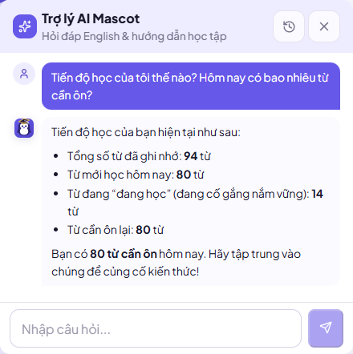
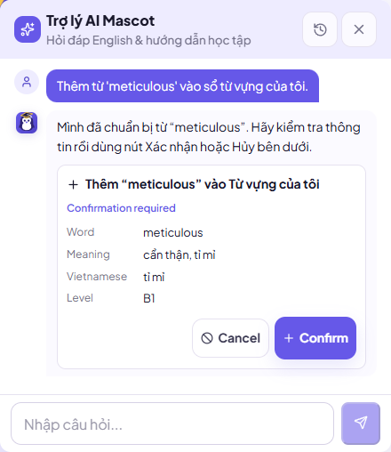
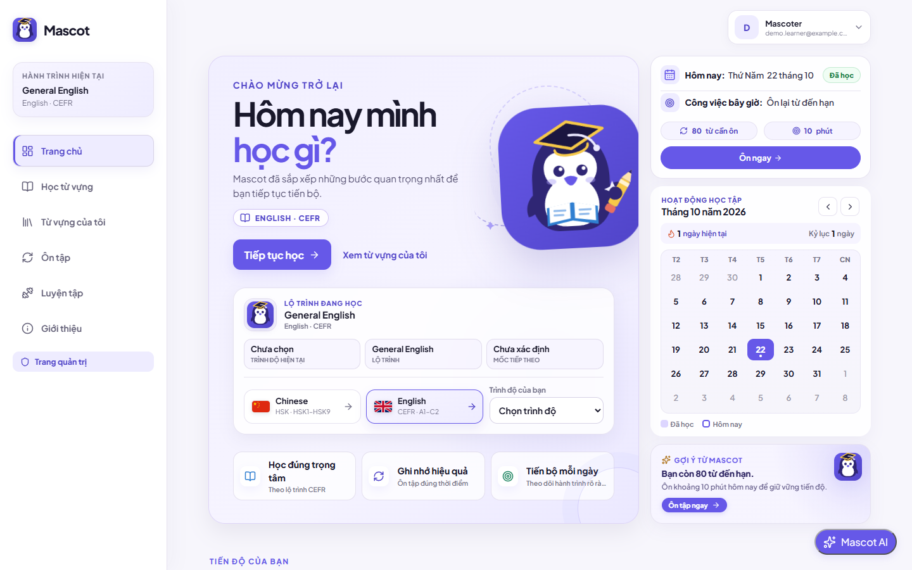
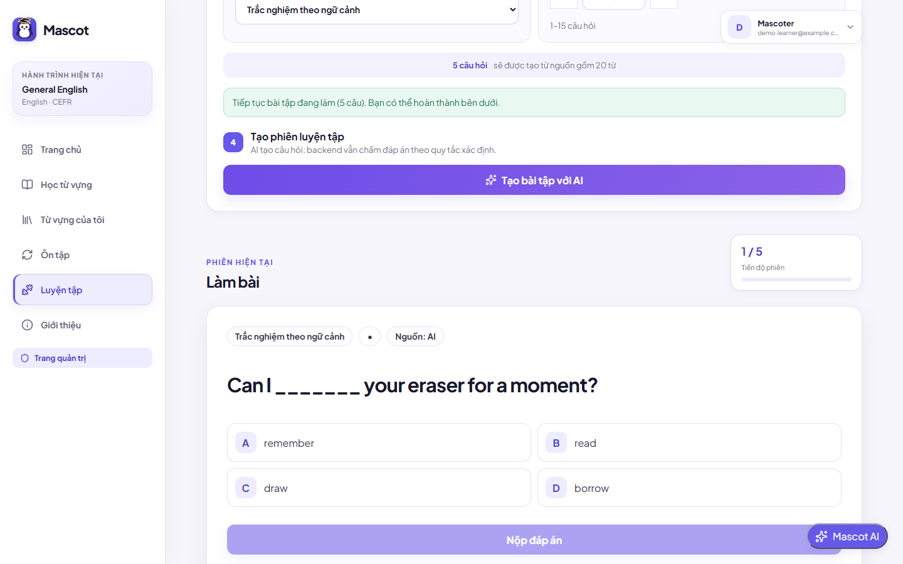
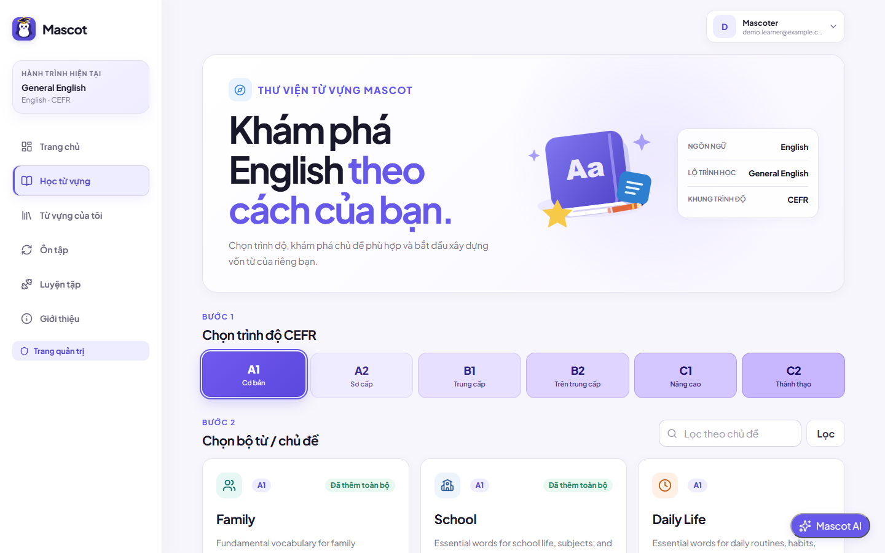
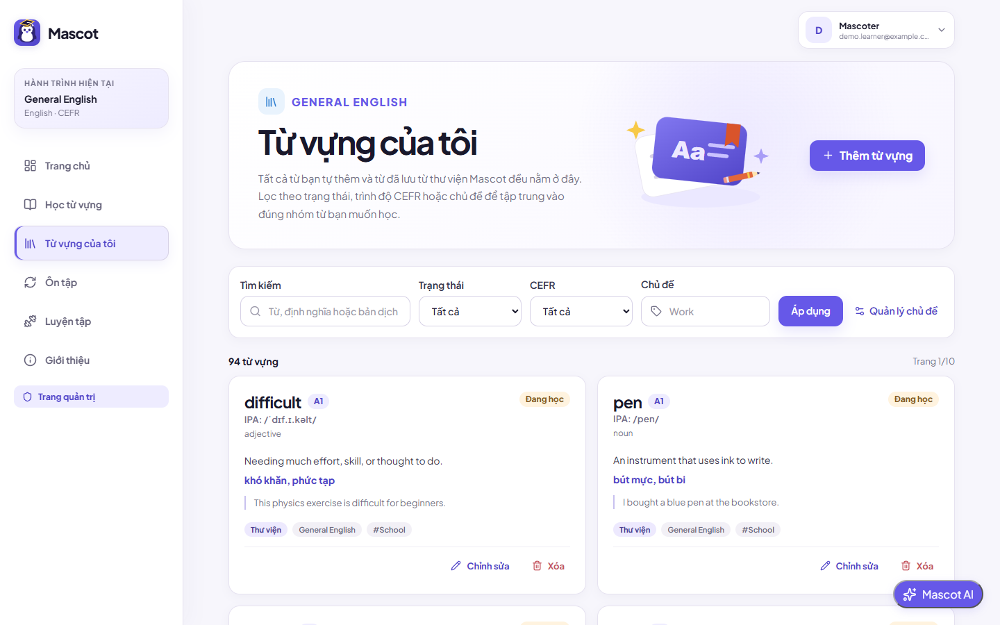
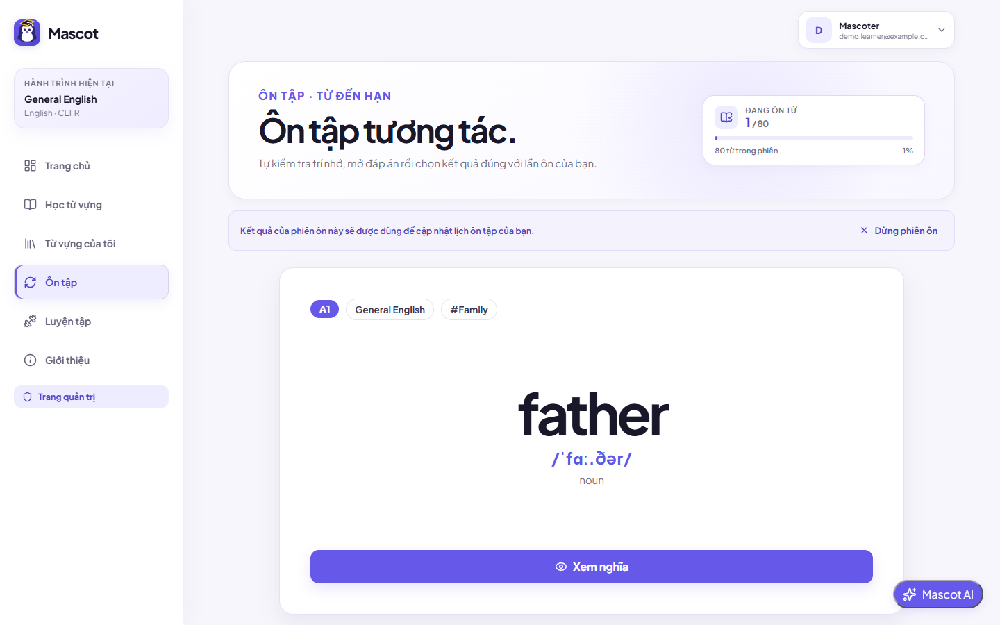
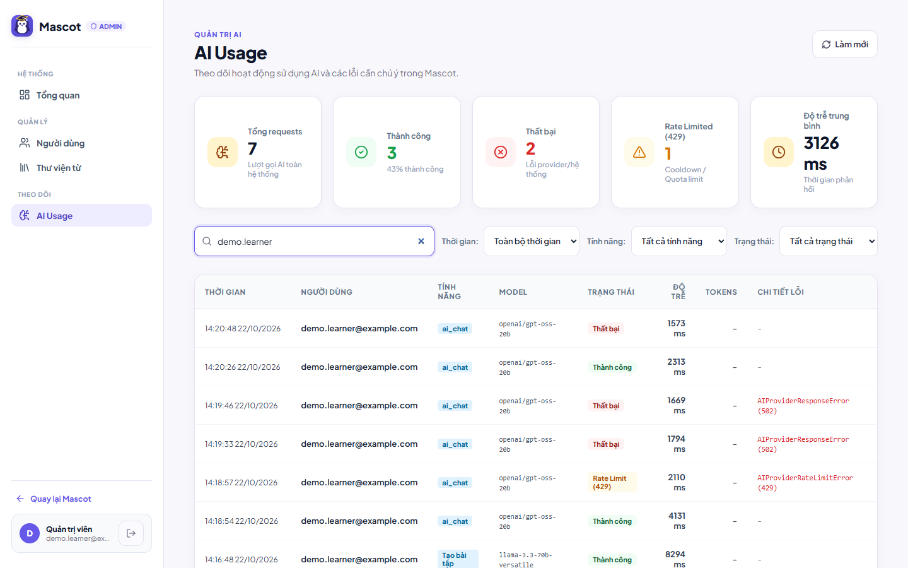

# Mascot

Mascot is an AI-assisted language learning app. Learners build a personal vocabulary notebook from a curated CEFR A1–C2 English catalog (plus an HSK Chinese starter track), review words with spaced repetition, practice with AI-generated exercises, and ask an **AI Learning Assistant** about their own progress.

The assistant is a bounded **LangGraph tool-calling agent**: it can read the learner's real data through whitelisted tools, but it can only *propose* changes. Nothing is written to the database until the learner confirms.

**Live demo:** [mascot-ai-learn.vercel.app](https://mascot-ai-learn.vercel.app) · **API health:** [mascot-114p.onrender.com/api/v1/health](https://mascot-114p.onrender.com/api/v1/health)

> The backend runs on Render's free tier, so the first request after a period of inactivity can take up to a minute while the service wakes up.

---

## Screenshots

The interface is in Vietnamese; the content being learned is English (and Chinese).

| AI assistant answers from the learner's real data | AI proposes a write and waits for confirmation |
|:---:|:---:|
|  |  |
| **Dashboard** | **AI practice, graded by the backend** |
|  |  |
| **CEFR A1–C2 catalog** | **Personal vocabulary notebook** |
|  |  |
| **Spaced-repetition review** | **Admin: AI usage monitoring** |
|  |  |

---

## Features

**Learning**
- **CEFR A1–C2 catalog**: 2,295 curated English entries in 48 topic sets, with IPA, definitions and bilingual examples. An HSK 1 Chinese starter set shows the multilingual track.
- **Personal notebook**: per-user vocabulary with search, filters, topics and normalized duplicate detection; users can never see each other's data.
- **Spaced repetition**: words move through `new → learning → review → mastered` with interval scheduling, a daily review queue and a study streak.
- **AI practice**: sentence-cloze questions and 4-blank reading passages generated from the learner's own words. Answers are graded by deterministic backend rules, not by the model.

**AI Learning Assistant**
- **Agentic tool calling**: the model decides which read tools to call (`get_learning_stats`, `get_due_vocabulary`, `get_learning_profile`), then answers from the results.
- **Human-in-the-loop writes**: `add_vocabulary` only returns a proposal. The backend issues a signed, expiring, single-use action token, and the database changes only after the user clicks **Confirm**.
- **Guardrails**: tool whitelist, Pydantic validation of every argument, user identity taken from the JWT (never from the model), per-round and total tool-call limits, payload and time limits, prompt-injection rules, and sanitized errors.
- **Memory and language**: conversations are saved per user, and replies follow the user's language.
- **Evaluation and observability**: a 43-case offline eval suite (normal chat, tool routing, injection, guardrails, confirmation security) and per-request logs of latency, tool rounds and token usage. No secrets are logged.

**Platform**
- JWT authentication with Argon2id password hashing, and password reset through hashed, single-use, 20-minute links.
- Admin portal (RBAC) for users, the shared catalog, and AI usage monitoring.

---

## Tech Stack

| Layer | Technologies |
|---|---|
| **Frontend** | React 19, TypeScript, Vite, React Router |
| **Backend** | Python 3.11–3.14, FastAPI, Pydantic v2, SQLAlchemy 2, Alembic |
| **AI** | LangGraph, LangChain Core, OpenAI-compatible Chat Completions API (Groq by default: `openai/gpt-oss-20b` for chat, `openai/gpt-oss-120b` for exercises; OpenAI as fallback) |
| **Database** | PostgreSQL 16 |
| **Security** | JWT (HS256), Argon2id, RBAC |
| **Email** | Gmail SMTP, Resend, Brevo |
| **Infrastructure** | Docker, Docker Compose, Vercel (frontend), Render (backend), Neon (PostgreSQL); also self-hosted on an Oracle Linux 9 VM |

---

## Architecture

```text
 React SPA (Vercel)
        │  HTTPS / REST, JWT bearer
        ▼
 FastAPI backend (Render / Docker)
   ├── Auth, vocabulary, review, exercises, admin  ──►  PostgreSQL (Neon)
   ├── AI Learning Assistant
   │     LangGraph:  START → model ⇄ tools → END
   │       read tools  ──► run inside the loop
   │       write tools ──► stop the loop, return a pending action
   │                         └─► POST /ai/actions/confirm (signed token) ──► database
   ├── AI exercise and vocabulary generation  ──►  Groq / OpenAI
   └── Password reset email  ──►  Gmail SMTP / Resend / Brevo
```

More detail: [System architecture](docs/ARCHITECTURE.md) · [AI assistant architecture](docs/ai/ARCHITECTURE.md) · [AI design decisions](docs/ai/DECISIONS.md)

---

## Quality

- **Backend:** 361 pytest tests (auth, data isolation, spaced repetition, grading, admin RBAC, AI guardrails, agent and tool execution).
- **Frontend:** 76 tests with the Node.js test runner, plus a type-checked production build.
- **AI evals:** 43 offline cases with a scripted provider, so they run without network access or token cost.
- **Migrations:** 14 linear Alembic revisions, head `20260908_0014`.

```bash
cd backend && pytest -q && python -m evals.run_chatbot_evals
cd frontend && npm test && npm run build
```

---

## Local Development

**Prerequisites:** Python 3.11+, Node.js 22.12+, Docker Desktop.

```bash
# 1. Environment files (then set POSTGRES_PASSWORD, JWT_SECRET_KEY and GROQ_API_KEY)
cp .env.example .env
cp backend/.env.example backend/.env
cp frontend/.env.example frontend/.env

# 2. PostgreSQL 16 on localhost:5432 (any local install works; this uses Docker)
docker run -d --name mascot-db --env-file .env -p 5432:5432 postgres:16-alpine

# 3. Backend and frontend in Docker (they reach PostgreSQL through host.docker.internal:5432)
docker compose up -d --build
docker compose exec backend python -m alembic upgrade head
```

To run without Docker instead:

```bash
# Backend (from backend/)
python -m venv .venv
source .venv/bin/activate        # Windows: .\.venv\Scripts\Activate.ps1
pip install -e ".[dev]"
python -m alembic upgrade head
uvicorn app.main:app --reload

# Frontend (from frontend/, in a second terminal)
npm ci
npm run dev
```

The app runs at `http://localhost:5173` and the API docs at `http://localhost:8000/docs`. To open the admin portal, register an account and run `python scripts/set_admin.py <email>` from `backend/`.

Full guide: [Development](docs/DEVELOPMENT.md) · [Deployment](docs/DEPLOYMENT.md) · [Self-hosting on an Oracle Cloud Always Free VM](docs/DEPLOY_ORACLE_CLOUD.md) · [Security](docs/SECURITY.md)

---

## Built with AI coding agents

Mascot was built during my Data & AI internship with Claude Code and Codex as pair programmers. The repo carries the context those agents need:

- [`CLAUDE.md`](CLAUDE.md) and [`AGENTS.md`](AGENTS.md): project map, architectural rules the agent must not break, and working rules.
- [`.claude/commands/`](.claude/commands): `/verify` (picks and runs the right checks for the changed files) and `/explain`.
- [`.agents/skills/`](.agents/skills): the same `verify` workflow packaged as an agent skill.

---

## Author

**Chu Quoc Dat** · [GitHub](https://github.com/cupeedrl) · [LinkedIn](https://www.linkedin.com/in/dat-chu-quoc-583599387/) · cqdatt41@gmail.com
